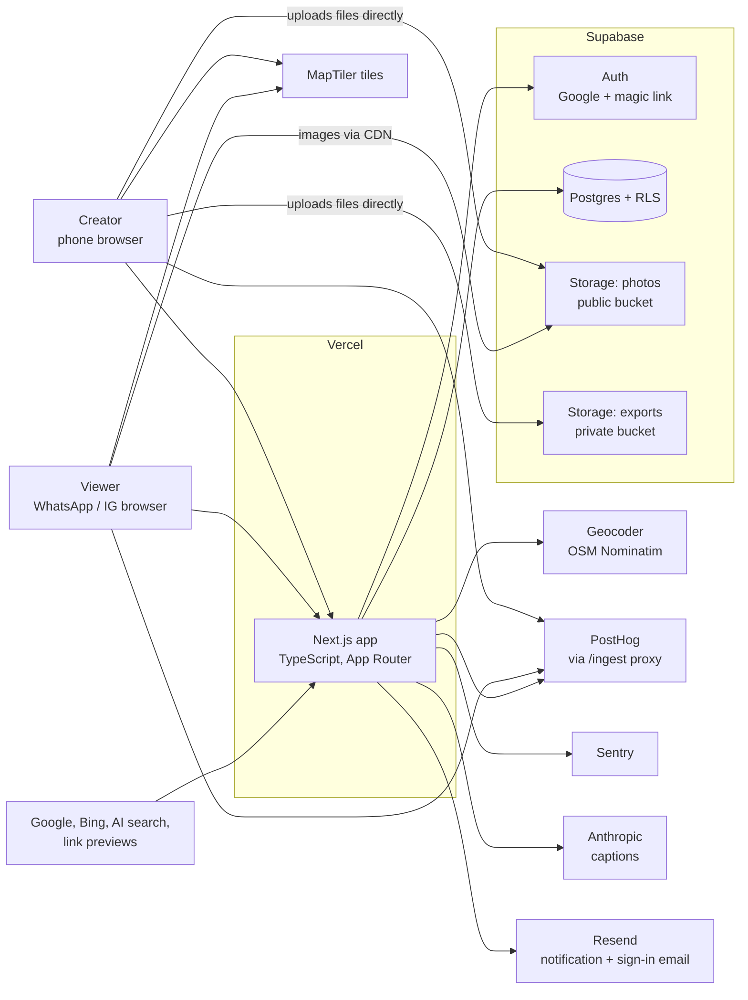
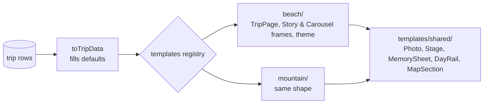
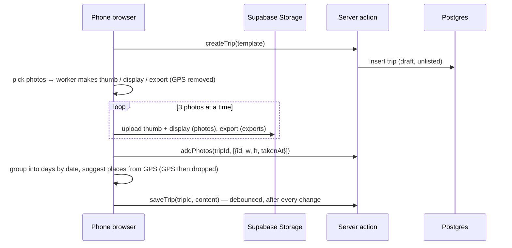

# OnQuest: High-Level Design (HLD), lean v1

Companion to `travel-scrapbook-mvp-prd.md` (v2). Read with `02-lld.md`, `03-security-visibility-seo.md` and `CLAUDE.md`.

Design goal: **the simplest system that is safe, fast on a phone, and makes adding templates and pages easy.** Anything not needed for the friends test is listed in §9 "Later", not built.

---

## 1. Constraints

| | |
|---|---|
| Team | 2 people, ~4 weeks to friends test |
| Scale (v1) | Hundreds of users, a few thousand trips. 100x should need tuning, not a rewrite |
| Budget | Vercel Hobby (CTO, 10 Nov: no monetisation in the MVP; accepted risk that Hobby's terms read as non-commercial and allow one member; move to Pro the day Vercel flags anything or something earns money), Supabase Pro organisation (prod + preview projects, both on Pro), Resend free (100/day; notification emails capped at 70/day in code so sign-in links always send), Anthropic pay-as-you-go (Haiku 5.5, ≈ $0.0005 per Quest), Nominatim (free, 1 request/s, cached in Postgres), free tiers for maps/analytics |
| Must be great at | Mobile trip page, smooth upload, pretty WhatsApp link previews |
| Must not do | Leak unlisted/private trips, leak photo GPS, lose a draft |

Rules we design by:
1. **Public pages are cached HTML**, refreshed when the owner saves.
2. **The phone does the image work** (resize, EXIF, Instagram rendering). No image servers.
3. **The database enforces privacy** (RLS). App code never decides alone who sees what.
4. **Templates are plain React components** that take `TripData` and return markup. A new template is a new folder.
5. **Records are never updated in place.** Each record has one permanent key; every save moves the current row to the archive and inserts the new one under the same key, and all lookups are by key (`docs/decisions/0001-no-in-place-updates.md`). How the MVP does it (archive tables, a trip as one document, a separate working draft) is in `docs/specs/onquest-mvp-a-create.md` §3.1 and §5.

The MVP (`docs/prds/onquest-mvp.md`) is specified in three specs: A, data model + create flow (`docs/specs/onquest-mvp-a-create.md`); B, Quest page, likes, comments, notifications, views, export (`docs/specs/onquest-mvp-b-quest-page.md`); C, social layer (`docs/specs/onquest-mvp-c-social.md`). Where this document and a spec differ, the spec wins until this document is next revised.

---

## 2. System overview

---

## 3. Building blocks

### 3.1 Next.js app

One codebase, two kinds of pages:

| Kind | Routes | How it renders |
|---|---|---|
| **Public** | `/`, `/demo`, `/@handle`, `/@handle/slug`, `/guides/[slug]`, OG images, `sitemap.xml`, `robots.txt` | Server-rendered, cached by tag, refreshed on save. Viewer-specific bits (liked, owner, following) load in the browser from small no-store routes |
| **App** (logged in) | `/login`, `/onboarding`, `/welcome`, `/home`, `/explore`, `/quests`, `/quests/new`, `/quests/[key]/{photos,arrange,review,template,preview,share,view,export}`, `/notifications`, `/settings`, `/settings/profile`, `/@handle/followers`, `/@handle/following` | Dynamic; editor state in Zustand; writes through server actions |

- `/@handle` URLs: Next.js reserves folders starting with `@`, so real folders are `app/u/[handle]/...` and a rewrite in `next.config.ts` maps `/@:handle/:slug?` onto them.
- Next.js 16 uses `proxy.ts` (formerly `middleware.ts`). Ours only refreshes the Supabase session on app routes.

### 3.2 Supabase

| Piece | Use |
|---|---|
| Auth | Google + email magic link. Session in httpOnly cookies (`@supabase/ssr`) |
| Postgres | Live tables `profiles`, `trips` (one document: content, photos, places), `trip_drafts`, `likes`, `comments`, `follows`, `notifications`, `notification_reads`, each data table with an `_archive` twin; insert-only `handle_claims`, `removed_trip_urls`. Owner-only select RLS, no update anywhere; writes only through save functions. Public pages read through `get_*`/`list_*` functions (specs A–C §4) |
| Storage `photos` (public) | `thumb.webp` + `display.webp` for every photo, under random-UUID paths |
| Storage `exports` (private) | `export.jpg` (high-res, for Instagram). Owner-only |
| Keys | New **publishable** key in browser, **secret** key on server only (legacy anon/service_role keys retire end of 2026) |

### 3.3 Outside services

| Service | Use | If it's down |
|---|---|---|
| MapTiler + MapLibre GL | Trip + profile map | Page shows the place list instead |
| OpenStreetMap Nominatim (free; Geoapify as fallback) | Place search + reverse geocode (behind `lib/geo.ts`, 1 request/s, cached) | User types place name, drops pin |
| PostHog | Analytics + feedback | No-op |
| Sentry | Errors | Vercel logs |
| Resend | Magic-link email (as Supabase SMTP) and notification emails | Google login still works; bell still shows notifications |
| Anthropic (Claude Haiku 5.5) | Short captions from date + town name while arranging | Quest is arranged without captions |

---

## 4. Templates (the extension point)

- Every template exports the same `Template` object: `theme`, `TripPage`, `StoryFrames`, `CarouselFrames`.
- Shared building blocks (photo frames, the swipe rail, the memory sheet, the map) live in `templates/shared`, so a new template is mostly layout + CSS + assets.
- Templates get clean `TripData` (no missing fields) and never fetch data.

---

## 5. Main flows

### 5.1 Sign up
Login (Google / magic link) → `/auth/callback` → no profile? → `/onboarding` (handle, name, avatar) → home.

### 5.2 Create a trip

MVP flow (pick 3–15 photos → arrange into ≤ 5 pages → review → template → preview → publish): `docs/specs/onquest-mvp-a-create.md` §3.2. The diagram below is the v1 shape; differences: `createQuest` on the first pick, metadata read before upload so arranging doesn't wait, `export.jpg` uploaded last, every save is `saveQuestDraft(key, basedOn, document)`.

The user keeps going (days, places, words) while uploads finish. Uploads are in memory with retries. If the user refreshes mid-upload, photos that didn't finish show as "re-add".

### 5.3 Publish / change visibility / edit
- **Publish:** `publish_trip` copies the working draft into a new `trips` row (the old one is archived); slug fixed at first publish (unlisted gets a random suffix) → refresh `trip-url`, `trip-social`, `profile` tags.
- **Edit after publish:** edits autosave to `trip_drafts` only; the live page changes on the next Publish.
- **Visibility change:** new `trips` row, same URL, refresh tags. No file moves.
- **Delete trip:** delete the trip's storage folders, then `delete_trip` removes live + archived rows and children and leaves a URL tombstone ("This Quest was removed.").
- **Delete account:** files, then `delete_account_data` (every row, live and archived), then the auth user.

### 5.4 View a trip
Cached HTML → thumbs first, `display` images as they come into view → map loads only when scrolled near.

### 5.5 Instagram export
All in the browser: load export images → render each frame at 1080×1350 / 1080×1920 → JPEG → user taps **Share** (native share sheet) or downloads a ZIP.

### 5.6 Link previews
Each trip and profile has an `opengraph-image.tsx` (1200×630 card). Cached with the page.

---

## 6. Caching

| Page | Cached? | Refreshed when |
|---|---|---|
| `/@handle/slug` (public, unlisted) | Yes, tag `trip-url:{handle}/{slug}` | Publish, visibility change, delete, handle change (old and new handle) |
| Likes and comments on a Quest page | Yes, tag `trip-social:{tripKey}` | Like, unlike, comment, comment delete, comments on/off |
| `/@handle` | Yes, tag `profile:{ownerKey}` | Any public trip change, profile edit, follow/unfollow (both people) |
| OG images | Yes, same tags | Same |
| Explore lists | 5 minutes, tag `explore` | Time |
| `/guides/[slug]` | Static; linked Quests tag `guide-quests`, 1 hour | Deploy / time |
| App routes, feed, search, notifications | Never | — |

Private Quests keep their URL, which shows "This Quest is private." The owner sees them at `/quests/[key]/view`.

---

## 7. Environments

| Env | Database |
|---|---|
| Local | `supabase start`, seeded with the Goa demo trip |
| Vercel Preview | Points at the Supabase **preview** project (on the Pro org, so no pausing; writes allowed, so the UX test can create Quests). Its own keys; never prod's secret key |
| Production | Supabase Pro, spend cap on, daily backups |

CI: typecheck, lint, unit tests, database access tests against a local Supabase, one Playwright smoke test.

---

## 8. Targets

| | |
|---|---|
| Trip page | LCP < 2.5 s (4G mid Android), INP < 200 ms, CLS < 0.1 |
| Upload | 15 photos in background; UI never blocks; arranged draft ≤ 60 s after the last upload on 4G |
| Export | 12 frames < 12 s on a recent phone |

---

## 9. Later (designed for, not built)

| Feature | What already makes it easy |
|---|---|
| "Everyone's Goa trips" pages | `places.geo_ref`, `city`, `country_code` saved from day one |
| Making photos truly private on visibility change | All storage calls go through `lib/storage.ts` (add a private bucket + signed URLs there) |
| Slug changes with redirects | Slugs are fixed at first publish; a slug history table would add redirects |
| Resumable uploads across refresh | Upload code is isolated in `features/editor/upload.ts` |
| Server-side export | Frame components are pure |
| Move photos to Cloudflare R2 | `lib/storage.ts` |
| Rate limits, CAPTCHA, report form | Add when abuse appears (§B in security doc) |
