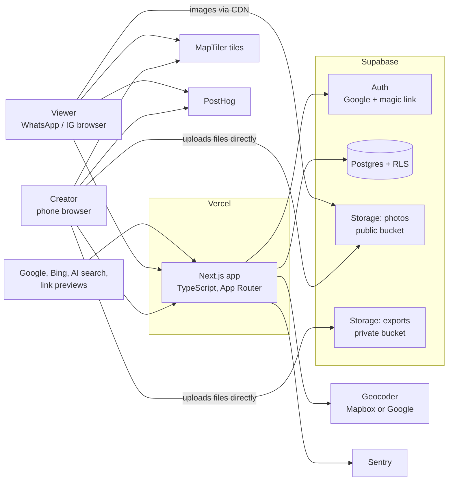
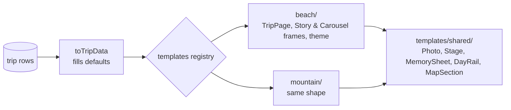
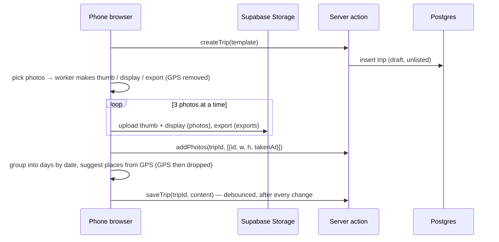

# OnQuest: High-Level Design (HLD), lean v1

Companion to `travel-scrapbook-mvp-prd.md` (v2). Read with `02-lld.md`, `03-security-visibility-seo.md` and `CLAUDE.md`.

Design goal: **the simplest system that is safe, fast on a phone, and makes adding templates and pages easy.** Anything not needed for the friends test is listed in §9 "Later", not built.

---

## 1. Constraints

| | |
|---|---|
| Team | 2 people, ~4 weeks to friends test |
| Scale (v1) | Hundreds of users, a few thousand trips. 100x should need tuning, not a rewrite |
| Budget | Vercel, Supabase Pro (one project), free tiers for maps/analytics |
| Must be great at | Mobile trip page, smooth upload, pretty WhatsApp link previews |
| Must not do | Leak unlisted/private trips, leak photo GPS, lose a draft |

Rules we design by:
1. **Public pages are cached HTML**, refreshed when the owner saves.
2. **The phone does the image work** (resize, EXIF, Instagram rendering). No image servers.
3. **The database enforces privacy** (RLS). App code never decides alone who sees what.
4. **Templates are plain React components** that take `TripData` and return markup. A new template is a new folder.

---

## 2. System overview

---

## 3. Building blocks

### 3.1 Next.js app

One codebase, two kinds of pages:

| Kind | Routes | How it renders |
|---|---|---|
| **Public** | `/`, `/demo`, `/@handle`, `/@handle/slug`, OG images, `sitemap.xml`, `robots.txt` | Server-rendered, cached by tag, refreshed on save |
| **App** (logged in) | `/login`, `/onboarding`, `/new`, `/trips/[id]/edit`, `/trips/[id]/preview`, `/trips/[id]/export`, `/settings` | Dynamic; editor state in Zustand; writes through server actions |

- `/@handle` URLs: Next.js reserves folders starting with `@`, so real folders are `app/u/[handle]/...` and a rewrite in `next.config.ts` maps `/@:handle/:slug?` onto them.
- Next.js 16 uses `proxy.ts` (formerly `middleware.ts`). Ours only refreshes the Supabase session on app routes.

### 3.2 Supabase

| Piece | Use |
|---|---|
| Auth | Google + email magic link. Session in httpOnly cookies (`@supabase/ssr`) |
| Postgres | 4 tables: `profiles`, `trips`, `places`, `photos`. Owner-only RLS. Public pages read through 3 small database functions |
| Storage `photos` (public) | `thumb.webp` + `display.webp` for every photo, under random-UUID paths |
| Storage `exports` (private) | `export.jpg` (high-res, for Instagram). Owner-only |
| Keys | New **publishable** key in browser, **secret** key on server only (legacy anon/service_role keys retire end of 2026) |

### 3.3 Outside services

| Service | Use | If it's down |
|---|---|---|
| MapTiler + MapLibre GL | Trip + profile map | Page shows the place list instead |
| Mapbox or Google Places | Place search + reverse geocode (behind `lib/geo.ts`) | User types place name, drops pin |
| PostHog | Analytics + feedback | No-op |
| Sentry | Errors | Vercel logs |
| Resend | Magic-link email | Google login still works |

---

## 4. Templates (the extension point)

- Every template exports the same `Template` object: `theme`, `TripPage`, `StoryFrames`, `CarouselFrames`.
- Shared building blocks (photo frames, the swipe rail, the memory sheet, the map) live in `templates/shared`, so a new template is mostly layout + CSS + assets.
- Templates get clean `TripData` (no missing fields) and never fetch data.

---

## 5. Main flows

### 5.1 Sign up
Login (Google / magic link) → `/auth/callback` → no profile? → `/onboarding` (handle, name, avatar) → home.

### 5.2 Create a trip

The user keeps going (days, places, words) while uploads finish. Uploads are in memory with retries. If the user refreshes mid-upload, photos that didn't finish show as "re-add".

### 5.3 Publish / change visibility / edit
- **Publish:** set visibility + slug → `status = published` → refresh cache for the trip and owner's profile.
- **Edit after publish:** same editor. Save updates the live page.
- **Visibility change:** update the row and refresh the cache. No file moves.
- **Delete trip:** delete the trip's storage folders, then the row (places/photos cascade).
- **Delete account:** delete all trips as above, then the auth user.

### 5.4 View a trip
Cached HTML → thumbs first, `display` images as they come into view → map loads only when scrolled near.

### 5.5 Instagram export
All in the browser: load export images → render each frame at 1080×1350 / 1080×1920 → JPEG → user taps **Share** (native share sheet) or downloads a ZIP.

### 5.6 Link previews
Each trip and profile has an `opengraph-image.tsx` (1200×630 card). Cached with the page.

---

## 6. Caching

| Page | Cached? | Refreshed when |
|---|---|---|
| `/@handle/slug` (public, unlisted) | Yes, tag `trip:{id}` | Save, publish, visibility change, delete |
| `/@handle` | Yes, tag `profile:{ownerId}` | Any public trip change, profile edit |
| OG images | Yes, same tags | Same |
| `/trips/*`, `/settings` | Never | — |

Private trips have no public URL at all. The owner sees them at `/trips/[id]/preview`.

---

## 7. Environments

| Env | Database |
|---|---|
| Local | `supabase start`, seeded with the Goa demo trip |
| Vercel Preview | Points at prod in read-only UI mode (`NEXT_PUBLIC_READONLY=1`). No secret key in Preview |
| Production | Supabase Pro, spend cap on, daily backups |

CI: typecheck, lint, unit tests, database access tests against a local Supabase, one Playwright smoke test.

---

## 8. Targets

| | |
|---|---|
| Trip page | LCP < 2.5 s (4G mid Android), INP < 200 ms, CLS < 0.1 |
| Upload | 30 photos in background; UI never blocks |
| Export | 12 frames < 12 s on a recent phone |

---

## 9. Later (designed for, not built)

| Feature | What already makes it easy |
|---|---|
| Follow / feed / likes | `profiles.id` is the user id everywhere; `published_at` indexed |
| "Everyone's Goa trips" pages | `places.geo_ref`, `city`, `country_code` saved from day one |
| Making photos truly private on visibility change | All storage calls go through `lib/storage.ts` (add a private bucket + signed URLs there) |
| Unpublished edits on a live trip, slug changes with redirects | Add a `draft_content` column and a slug history table |
| Resumable uploads across refresh | Upload code is isolated in `features/editor/upload.ts` |
| Server-side export | Frame components are pure |
| Move photos to Cloudflare R2 | `lib/storage.ts` |
| Rate limits, CAPTCHA, report form | Add when abuse appears (§B in security doc) |
